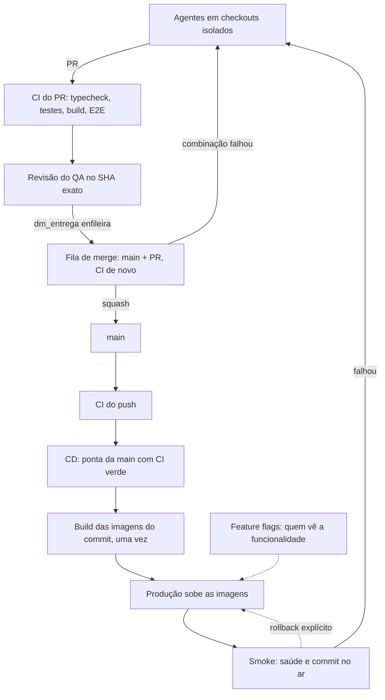

# Integração e produção

Como uma mudança sai de um PR e chega a produção. As regras que decidem estão em código com testes (`scripts/aponta_release.py`) e nas proteções do repositório; este documento explica e não substitui nenhuma delas. Não há staging: o que protege a produção é o CI (incluindo E2E), a revisão do QA, a fila de merge, a aprovação do deploy e o smoke depois da troca.

## Fluxo

Feature flag não é uma etapa: é um controle da funcionalidade, lido em tempo de execução.

## Integração de agentes em paralelo

- Cada PR roda o CI sozinho e em paralelo com os outros (`concurrency` por PR; um push novo cancela só o run anterior do mesmo PR).
- Dois PRs verdes isolados não provam que a combinação funciona. Quem prova é a **fila de merge nativa** (regra `main`, ruleset 26762558): monta um commit candidato com a `main` atual mais o PR, roda `Typecheck, unit tests, build` e `E2E (Playwright, full stack)` nele e só então integra.
- A fila integra um PR por vez (`max_entries_to_merge: 1`, `ALLGREEN`), então cada candidato já contém o que entrou antes.
- Os nomes dos checks são os nomes dos jobs e não mudam com o evento. Nenhum job obrigatório tem `continue-on-error` nem condição que o pule; check ausente, cancelado ou pendente não libera a fila.
- Atualizar a branch com a `main` não é exigido (`strict` desligado): a fila testa a combinação.

## Artefato

`docker-compose.yml` nomeia as imagens pelo commit: `aponta-api:<sha>`, `aponta-web:<sha>`, `aponta-storybook:<sha>`. O deploy constrói uma vez, a partir da árvore exportada do commit (`git archive`), e produção sobe com `--no-build` essas imagens. O identificador de cada imagem fica no registro do commit.

- A API devolve o commit em `GET /api/version`; o front, em `/version.json`. O smoke compara os dois com o commit esperado.
- O bundle do front embute `VITE_API_URL` (`/api`, mesma origem, com proxy do nginx).
- Segredos e configuração ficam fora da imagem, em arquivos de ambiente no servidor: `.env.prod` e `.env`.
- Limite: as imagens existem só na VPS. Não há registro externo; o identificador é o da imagem local, não um digest de registro.

## Produção

`aponta_release.py deploy --sha <commit>` (chamado pelo `CD (Produção)`, dentro do environment `production`):

1. exporta a árvore do commit e recusa se o commit for mais antigo que o no ar, ou se não contiver o que está no ar (só `--rollback` volta, e apenas para um ancestral);
2. constrói as imagens do commit, se ainda não existirem;
3. sobe a produção com `up --wait --no-build`;
4. roda o smoke (página do front, saúde da API, commit da API e do front) e grava o resultado em `~/deploy/aponta/records/<sha>.json`.

Em produção o smoke só lê; não faz login nem cria dado. O workflow publica sempre a ponta da `main` com CI verde, e não o commit do CI que acabou de terminar; nenhum run em andamento é cancelado, para não interromper uma migração. Há trava no host (`~/deploy/aponta/locks/production.lock`): um deploy por vez.

Terminado o deploy com o smoke verde, o job `close-issues` do mesmo workflow roda `scripts/close_delivered_issues.py` com o commit publicado: fecha as issues da linha `Entrega: #N` dos PRs integrados que estão no histórico desse commit (com comentário de PR, commit e run) e fecha a SPEC pai quando a última sub-issue fecha. Se o deploy falha ou é recusado, nada fecha. Rollback não reabre issue.

Quando o CD termina, com sucesso ou falha, o job `notify` comenta no card do Multica de cada entrega do intervalo publicado (do commit em produção antes do run até a ponta), mencionando o `dm_lider`, com commit, PR, run e, no sucesso, o que `/api/version` e `/version.json` devolvem. A entrega é o `DMTE-N` do título do PR (ou do nome da branch), e o card é a issue do Multica com esse identificador. O aviso nunca muda o resultado do deploy.

Sem staging e sem aprovação manual, o **primeiro** deploy de cada mudança acontece em produção, sozinho, depois da fila. O que segura o risco: o QA no SHA exato, o CI e a fila validando a combinação, o smoke que confere o commit no ar, o rollback rápido (`deploy --rollback`) e a funcionalidade com efeito externo novo entrando atrás de feature flag desligada.

## Recuperação

- **Aplicativo**: `python3 ~/deploy/aponta/releases/<sha-atual>/scripts/aponta_release.py deploy --sha <sha-anterior> --rollback`. O alvo precisa ser ancestral do commit no ar; se as imagens ainda existem no servidor não há build, senão elas são reconstruídas da árvore do commit.
- **Banco**: rollback de código não desfaz migração. Migrações seguem expandir e contrair: a versão anterior do código precisa funcionar com o schema novo. Para desfazer dado, o caminho é o backup (`scripts/backup.sh`, dump diário com sete dias de retenção), decidido pelo usuário.
- **Efeitos externos**: e-mail enviado não volta.

## Feature flags

Registro em `apps/api/src/feature-flags/feature-flags.ts`: chave, descrição, responsável, valor padrão e data de remoção. O valor por ambiente vem de `FEATURE_<CHAVE>` no arquivo de ambiente; `GET /api/feature-flags` devolve os valores e `useFeatureFlag` os lê no front, desligado por padrão em caso de dúvida. O teste do registro falha no CI quando uma flag passa da data de remoção.

## Isolamento

- **CI**: cada job roda numa máquina do GitHub, com o Postgres do próprio job. Nada é compartilhado entre execuções.
- **Agentes na VPS**: `scripts/e2e_isolated.sh` sobe um Postgres descartável e portas livres por execução e remove só os containers com o rótulo daquela execução. Agentes nunca rodam Docker contra a produção.

## Segurança dos workflows

- Actions fixadas pelo SHA do commit.
- `ci.yml` tem `contents: read` e não recebe secret; o checkout não persiste credencial. PR de fork roda sem secret.
- Não há `pull_request_target`. O deploy roda em `workflow_run`, só para CI de `push` na `main` com sucesso, e é o único workflow com os secrets `DEPLOY_*`.
- O deploy não executa código de PR: a árvore vem do commit da `main`, já revisado e validado na fila.

## Pendências

1. **Sem aprovação manual antes de produção**: o environment `production` não tem revisores, e o deploy sobe sozinho quando o CI da `main` passa. Para voltar a exigir aprovação: Settings → Environments → `production` → Required reviewers.
2. **Primeiro deploy pelo fluxo novo**: acompanhe o run.
3. **Não coberto**: imagens fora do servidor (registro), deploy sem nenhuma indisponibilidade na troca e bot de atualização de dependências.
